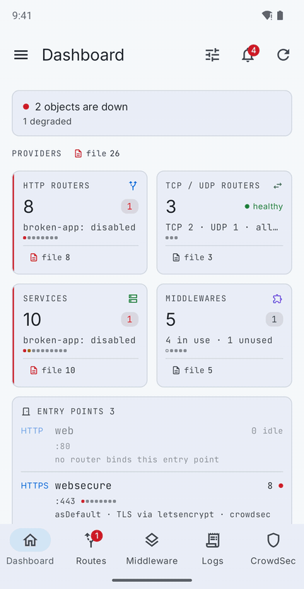
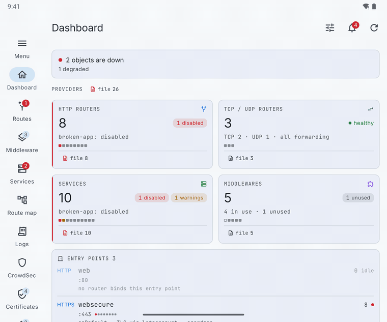
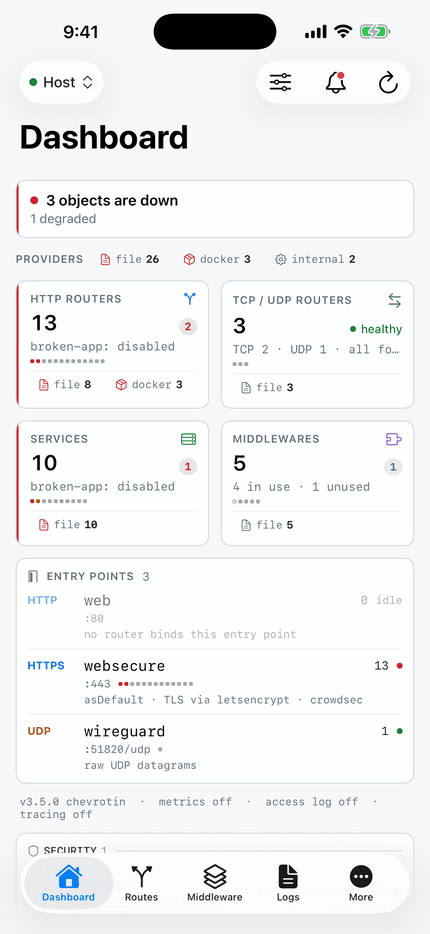
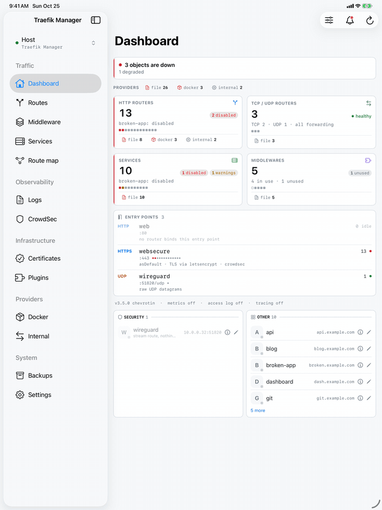

# Traefik Manager Mobile

Native Android and iOS companion app for [Traefik Manager](https://github.com/chr0nzz/traefik-manager) - manage your Traefik routes, middlewares, services and CrowdSec decisions from your phone or tablet.

> **Requires Traefik Manager v1.14.0 or higher.**

---

## Download

| Platform | Link |
| --- | --- |
| Android (APK) | [Latest release](https://github.com/chr0nzz/traefik-manager-mobile/releases/latest) |
| Google Play | [Install from Play Store](https://play.google.com/store/apps/details?id=dev.chr0nzz.traefikmanager) |
| iPhone and iPad | App Store - coming soon |

Both apps share one version number: the iOS app starts at 2.5.0, alongside Android.

---

## Screenshots

<div align="center">

<picture>
  <source media="(prefers-color-scheme: dark)" srcset=".github/assets/mobile-dark.gif">
  
</picture>

<sub>Android: Dashboard · Routes · Middlewares · Services · Route map · Logs · CrowdSec · Certificates · Plugins · Backups · Settings</sub>

<br /><br />

<picture>
  <source media="(prefers-color-scheme: dark)" srcset=".github/assets/tablet-dark.gif">
  
</picture>

<sub>The tablet layout swaps the bottom tab bar for a side rail and lays the cards out in two columns.</sub>

<br /><br />

<picture>
  <source media="(prefers-color-scheme: dark)" srcset=".github/assets/ios-dark.gif">
  
</picture>
&nbsp;
<picture>
  <source media="(prefers-color-scheme: dark)" srcset=".github/assets/ipad-dark.gif">
  
</picture>

<sub>On iPhone the tab bar holds the main screens and More the rest; on iPad a sidebar lists everything.</sub>

<br /><br />

[Browse every screen in the docs](https://traefik-manager.xyzlab.dev/ui-examples.html)

</div>


## Features

- **Overview** - the signal desk: routers, services and middlewares as cards with health, provider breakdown and entry points
- **Routes** - view, enable/disable, add, edit and delete HTTP/TCP/UDP routes, multiple domains per route, raw YAML editing
- **Middlewares** - 30 templates with guided wizards, plus edit, delete and htpasswd generation
- **Services** - health, backends up, provider filter and the routers each one serves, plus create, edit, rename and delete: load balancer, weighted, mirroring and failover, on the host or any agent
- **Logs** - live tail with CLF and JSON parsing, tappable facet filters and the v1.10 analytics cards
- **CrowdSec** - decisions and alerts, add and delete bans, the full stat desk and a world map
- **Certificates** - expiry thresholds and the resolvers in use
- **Plugins** - install, edit, remove and restart, with the middleware written for you
- **Static config** - edit `traefik.yml` and restart Traefik, on the host or any agent
- **Backups** - dynamic and static config backups, restore, and Git backup status, history, diff and push
- **Multi-server** - switch between the host and any agent from the drawer; tabs follow what each server actually runs
- **Notifications** - notification channels matching the web: Discord, Slack, ntfy, Gotify, Pushover, Pushbullet, Telegram or generic JSON, each with its own categories, severity, digest and quiet hours
- **Push** - on Android, events delivered to the phone over UnifiedPush; on iOS, new notifications shown as alerts when iOS lets the app check in the background
- **Home screen widgets** - any dashboard, certificate or CrowdSec card for one server, every server at a glance, and your app launcher
- **App lock** - optional biometric unlock (Face ID or Touch ID on iOS), with relock when the app goes to the background
- **Languages** - follows the phone's language, or one picked in Settings: Chinese (Simplified), Czech, Danish, Dutch, French, French (Canada), German, Portuguese, Portuguese (Brazil), Russian and Spanish, plus British and American English spellings
- **Opens on your last data** - every screen keeps its own snapshot per server and draws it immediately, then refreshes behind it

---

## Requirements

| Requirement | Version |
| --- | --- |
| Traefik Manager (server) | **v1.14.0 or higher**, v1.15.0 for server messages in the app's language |
| Android | 13+ (API 33) |
| iOS and iPadOS | 17+ |
| Push on Android (optional) | A UnifiedPush distributor, such as the ntfy app |
| To build Android | JDK 17 |
| To build iOS | Xcode 26 on a Mac |

---

## Getting Started

### 1. Generate an API key in Traefik Manager

In the Traefik Manager web UI go to **Settings → Authentication** and generate an API key. Copy it - you will need it during app setup.

### 2. Configure the app

Open the app and enter:

- **Instance URL** - the base URL of your Traefik Manager instance, e.g. `https://traefik-manager.example.com`
- **API Key** - the key generated in step 1

Tap **Connect**. To look around first, tap **Try Demo** for built-in sample data.

---

## Building from Source

The Android app is the Gradle project in `android/`; the native iOS app is in `ios/`.

```bash
cd android

# Debug build
./gradlew :app:assembleDebug

# Unit tests
./gradlew :app:testDebugUnitTest

# Signed release APK and Play bundle
./gradlew :app:assembleRelease :app:bundleRelease
```

Release builds are signed from a `keystore.properties` in `android/`, which is gitignored:

```properties
storeFile=/path/to/release.jks
storePassword=...
keyAlias=...
keyPassword=...
```

### iOS

Open `ios/TraefikManager.xcodeproj` in Xcode and run the **TraefikManager** scheme, or from a terminal:

```bash
cd ios

# Build for the simulator
xcodebuild -project TraefikManager.xcodeproj -scheme TraefikManager -destination 'generic/platform=iOS Simulator' build

# Unit tests
xcodebuild -project TraefikManager.xcodeproj -scheme TraefikManager -destination 'platform=iOS Simulator,name=iPhone 17 Pro' test

# Archive and upload to TestFlight (needs an App Store Connect API key)
ASC_KEY_ID=... ASC_ISSUER_ID=... scripts/testflight.sh
```

The App Store listing text, review notes and privacy answers are in `ios/media-kit/`.

---

## Tech Stack

### Android

- Kotlin 2.4 · [Jetpack Compose](https://developer.android.com/compose) with Material 3 Expressive
- [Hilt](https://dagger.dev/hilt/) for dependency injection
- [Retrofit](https://square.github.io/retrofit/) 3 · OkHttp 5 · kotlinx.serialization
- [DataStore](https://developer.android.com/topic/libraries/architecture/datastore) with an encrypted key store
- [Glance](https://developer.android.com/jetpack/androidx/releases/glance) and WorkManager for the widgets
- [UnifiedPush](https://unifiedpush.org) for push
- Robolectric and JUnit for tests, R8 with resource shrinking for release builds

### iOS

- Swift and SwiftUI, iOS 17+, no third-party dependencies
- WidgetKit with App Intents for the configurable widgets
- LocalAuthentication for the app lock, BackgroundTasks and UserNotifications for alerts
- String Catalogs for translations, generated from the Android strings
- XCTest for unit tests

---

## Translations

The app is translated on [Weblate](https://hosted.weblate.org/projects/traefik-manager/mobile/), in the same project as the web UI, so both share one glossary and translation memory. An account is needed to write, not to read. Nothing goes live on its own: Weblate opens a pull request here. The iOS app takes its translations from the same Android strings with `ios/scripts/i18n`, so one translation on Weblate serves both apps.

<a href="https://hosted.weblate.org/engage/traefik-manager/">

</a>

Style rules, the glossary and how to ask for a language are in [tm-locale](https://github.com/chr0nzz/tm-locale). A placeholder a translation drops or changes fails the build, so a translation cannot crash a screen.

---

## Community

Questions, help and release news: [Discord](https://discord.gg/vRQCMrrjtz)
